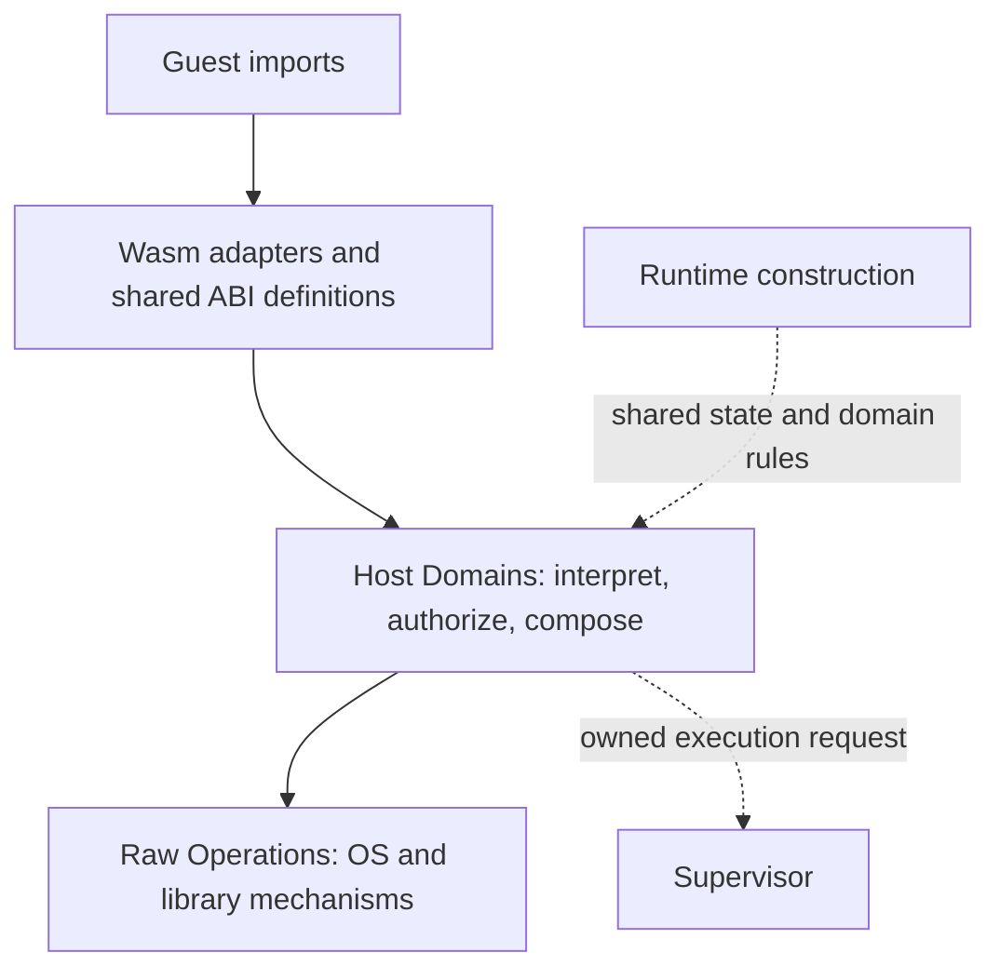

# Moonrun runtime architecture

This guide is the implementation contract for the direction accepted in
[ADR 0012](../../adr/0012-preserve-embeddability-and-runtime-owned-host-semantics.md).
Read it before changing the library interface, execution ownership, host imports,
virtualized state, or authorization. Terms are defined in
[CONTEXT.md](../../../CONTEXT.md); sequencing belongs in the
[architecture tracker](../architecture-tracking.md).

The requirements below describe the intended architecture. The current-state
notes identify incomplete enforcement; this document does not turn those gaps
into existing guarantees. Designs may revise the constraints explicitly, but
moving files or completing a tracking item must not silently weaken them.

## Relationship to earlier decisions

This architecture builds on existing decisions; ADR numbers are local to their
directory. The repository ADR 0001 and Moonrun ADR 0001 are different records.

| Existing decision | Constraint carried forward |
| --- | --- |
| Repository [0001: Async Wasm Host Boundary](../../../../../docs/adr/0001-async-wasm-host-boundary.md) | Keep host semantics independent of V8, preserve native-shaped behavior and provenance, borrow current Guest Memory, and report guest termination without exiting the embedding process |
| Moonrun [0001](../../adr/0001-copy-worker-results-through-host-completions.md), [0004](../../adr/0004-use-host-completion-queue-for-wasm-workers.md), [0007](../../adr/0007-split-read-job-guest-destination-from-host-buffer.md) | Workers retain host-owned inputs/results; copy output through a fresh guest borrow after completion |
| Moonrun [0002](../../adr/0002-preserve-native-shaped-worker-boundary.md), [0003](../../adr/0003-use-native-shaped-worker-threads-first.md), [0005](../../adr/0005-suspend-coroutines-for-wasm-worker-jobs.md), [0006](../../adr/0006-let-workers-own-running-jobs.md) | Preserve the Worker/Job contract, coroutine suspension, chosen thread execution model, and worker ownership of running Jobs; domain separation does not redesign the scheduler |
| Moonrun [0008: Acquired Resources](../../adr/0008-own-resources-behind-boundary-handles.md), [0009: One Handle Namespace](../../adr/0009-use-one-handle-namespace.md) | Validate and acquire resources at the ABI interface; Jobs retain references; Runtime owns one Handle namespace while domains own payloads; future resource rights belong to the acquired payload |
| Moonrun [0010: Stdio Compatibility](../../adr/0010-preserve-stdio-blocking-mode-for-compat-imports.md) | Compatibility imports must preserve embedding-owned descriptor blocking state |
| Moonrun [0011: Generic Stat Result](../../adr/0011-use-a-stable-host-owned-generic-stat-result.md) | Share one host-owned result/codec, keep platform acquisition separate from ABI encoding, and authorize requested metadata effects |

The glossary already defines Runtime Configuration, Runtime State, Moonrun
Policy, Host Domain, Raw Operation, and Wasm Adapter. The
[Rust library documentation](../../../README.md#rust-library) already describes
embedding. This guide connects those existing definitions to ownership and
implementation obligations; it does not claim to introduce them.

ADR 0012 adds internal command/supervisor ownership, a converged execution-host
interface, the derivation contracts, and the overall authority requirement. It
replaces the repository ADR 0001's original
module allocation, where `async_api` was V8-facing and `async_host` held the
general host state. It preserves that ADR's semantic and lifetime guarantees.
Its original V8/JS plumbing and deferred list are historical; the developer
index describes current implementation and the tracker records remaining work.

Related MoonBuild decisions keep their narrower scope. The
[`moon run` lifecycle design](../../../../../docs/dev/design/moon-run-process-lifecycle.md)
owns outer command execution and artifact delivery; its use of synchronous
child waiting does not choose the Moonrun library's scheduler. Repository
[ADR 0004](../../../../../docs/adr/0004-separate-command-results-from-user-logs.md)
owns MoonBuild command output, not the guest's Runtime Stdio or all Moonrun
diagnostics. Reuse their ownership lessons without importing unrelated modes.

## Library contract and execution ownership

Moonrun must remain usable without starting its CLI, creating a virtual process
tree, or invoking Moon. The CLI parses arguments, chooses configuration, connects
process signals, and translates returned outcomes into host-process exit
behavior. These actions stay outside the reusable execution interface.

The public interface should converge on one execution-host entry point. It
integrates preparation and execution with the admission and lifecycle behavior
needed by the request, while callers supply their execution configuration and
authority. Callers must not need to coordinate an Engine with a Supervisor or
construct a Command object. This is a target for public-interface convergence,
not a commitment to a new public type, naming scheme, or generic execution
framework. The following ownership remains internal to that interface.

| Owner | Responsibility | Existing implementation |
| --- | --- | --- |
| Embedding caller / CLI | Select execution placement, root configuration and grants, signal forwarding, shutdown policy, and outcome presentation | [Library exports](../../../src/lib.rs), [CLI](../../../src/main.rs) |
| Engine and Loaded Module | Prepare reusable guest code and provide synchronous execution; retain no mutable virtual environment between Runs | [engine.rs](../../../src/engine.rs) |
| Supervisor | Admit commands; own virtual identities, parentage, control, adoption, completion, and reaping | [process_tree.rs](../../../src/process_tree.rs) |
| Supervised Command lifecycle | Compose preparation, artifact execution, and cleanup under one stable identity; does not require a public Command object | [process_tree/command.rs](../../../src/process_tree/command.rs) |
| Run | Execute Wasm synchronously and return after its Runtime and guest execution state have torn down | `Engine::run` and its scoped implementation |
| Runtime | Realize one environment and wire its Host Domains, shared state, Handles, and authorization inputs | [runtime/mod.rs](../../../src/runtime/mod.rs) |

Current interface: [#2403](https://github.com/moonbitlang/moon/pull/2403) retains
public `Engine`, `Module`, `RunOptions`, `RunOutcome`, and `VirtualProcessTree`.
`Engine::run` executes on the calling thread; the caller can reuse modules and
choose its own scheduling. `VirtualProcessTree` adds supervision today. The
unified entry point is subsequent work and must preserve caller-thread
synchronous execution and module reuse. Internal `RuntimeConfig` and Host
Domains need not become public merely to make the library embeddable. Add public
configuration where callers need control, keeping one internal source for each
fact.

Whether a Moon/moonx request executes within the embedding host or through an
external process is an execution strategy behind the entry point. In-process
artifact execution may still use an external Moon helper for preparation. The strategy
must preserve the request's authority ceiling and explicit ownership of state,
completion, and cleanup. It must account for the different enforcement available
in an external process rather than claim that launch alone constrains it. This
keeps backend selection separate. Implement only the concrete execution
choices required by callers, without exposing the internal command workflow as
another configuration or object that they must manage.

Guest exit and termination return an outcome after teardown. They must not call
`process::exit`, kill the embedding host, or install the CLI's process-signal
broker. Backend initialization that genuinely must be process-wide is allowed,
but its lifetime and interference must be explicit. Diagnostics and Runtime
stdio are separate concerns: embedding callers need deliberate diagnostic
routing as well as guest stream bindings.

Within the execution host, Supervisor owns orchestration for admitted commands.
Converging the public interface must reuse that owner, not add a forwarding
orchestrator or a parallel process table.
Parentage, guest authority over a child, and cancellation membership are
different relationships. Killing one command must not implicitly kill siblings;
cancelling a build may need to stop its helper and compiler descendants. A
session shutdown policy may additionally include adopted commands.

The owner of a termination receiver finalizes its execution scope. A supervised
Run borrows control; its return cannot close the enclosing command. Accepted
termination remains authoritative through preparation and cleanup, while a
panic remains a process failure. Completion requires actual cleanup and reaping.
Cancelling a wait must preserve the child and an unread result. Neither
`Terminating` nor dropping a tree promises that blocked work has stopped.

Current limits: the library interface is experimental. Virtual process trees
and external forced interruption currently require V8; other backends must
report unsupported behavior instead of silently weakening the contract. The
CLI signal broker is separate, but worker interruption still installs Unix
process-wide signal behavior. Policy denials also still write to host stderr.
These are embedding ownership gaps, not reasons to put CLI behavior in Engine.

## Three layers for host operations

The three layers describe responsibilities, not a requirement for three crates
or a wrapper around every syscall. Runtime construction and supervision are
separate ownership concerns, outside the per-import call chain.

| Layer | Owns | Must leave to another owner |
| --- | --- | --- |
| ABI adaptation | Engine values, ABI layouts, checked Guest Memory borrows, import registration, error and termination delivery | Environment lookup, path meaning, process admission rules, and permission decisions |
| Host Domains | Interpretation using Runtime State and Handles, complete operation intent, authorization, composition, state updates, and semantic results | Engine handles and guest-memory lifetimes; OS-specific mechanics that do not change domain meaning |
| Raw Operations | OS calls, platform translations, native-library calls, and mechanical resource management | Selecting ambient state, inventing policy, or deciding which guest owns an object |

Shared ABI definitions are part of adaptation, not a fourth semantic layer.
Their main homes are [wasm_imports](../../../src/wasm_imports),
[async_api](../../../src/async_api), [host_imports.rs](../../../src/host_imports.rs),
and domain-specific import registrations. The V8, Wasmtime, and wee8 adapters
provide engine conversion and memory access. Pure value conversions need no
artificial Host Domain or permission check.

Host Filesystem, Host Network, Host Process, SQLite Host, and WASI own their
respective semantics. Env, Working Directory, and Stdio supply shared
Runtime-owned state. Workers schedule Jobs and deliver Completions; they do not
become a second owner of domain interpretation or authorization.

Raw Operations can remain private within a domain, such as
[process/ambient.rs](../../../src/process/ambient.rs), or live in
[async_sys](../../../src/async_sys). Keep platform-specific operations close to
their semantic owner. Reuse mature dependencies where appropriate, but account
for their implicit cwd, environment, signal, and library-global behavior.
Consolidating every primitive into one general OS facade is not a goal.

For an operation that touches host state, the required flow is:

1. Decode the ABI, validate its memory and Handle representation, and release
   guest borrows before asynchronous work or guest re-entry.
2. Let the domain interpret the request with the owning Runtime's state and
   resource provenance. Resolve defaults and derive every effect it can cause.
3. Authorize the complete intent before its effects. Lookup or preparation
   steps with their own host effects also need an authority decision. Resource
   validity and identity checks remain necessary at the last safe moment.
4. Execute the interpreted operation, then record the semantic result. Async
   work retains owned inputs and acquired resources, not a recipe that later
   re-reads ambient defaults or guest memory.

For example, a process request includes the executable, arguments, environment,
cwd, streams, execution kind, and child restrictions. Host Process owns their
interpretation and authorization; the Supervisor owns admission and lifecycle;
the command owns preparation and dispatch. Authorization and execution must
agree on the selected executable. A later phase must not redo PATH lookup with
a different environment. Introduce a prepared representation only when it owns
this resolved decision; do not duplicate the same fields across peer configs.

Current limits: existing Host Domains and shared registrations already provide
much of this structure. Some imports still directly expose primitives, and
Host Process currently splits policy checking from later configuration and
resolution. The next migration must join those decisions at their owner rather
than claim the final flow is already enforced everywhere.

## Virtualization and inheritance

Virtualization controls which state an operation observes. Authorization
controls which effects it may cause. Owned Env and a fixed cwd do not by
themselves constrain filesystem, network, or native-code access.

Every supervised command, including the first admitted command, receives an
owned environment and fixed cwd. The outer embedding host is the source of
explicit root inputs; it is not a privileged guest called PID 0. Ordinary
`Engine::run` still supports Ambient compatibility. That is an explicit mode
with host-observable effects, not an exception silently granted to tree roots.

| State | Root creation | Guest child derivation |
| --- | --- | --- |
| Env | Capture caller-selected values once, then provision the Runtime Env | Derive from parent state and the explicit child environment; mutations remain child-local |
| Working Directory | Select a fixed execution directory for supervised work | Resolve requested/default cwd from the parent's virtual state |
| Stdio and Resources | Bind explicitly granted resources | Validate and duplicate or delegate selected resources with deliberate ownership and rights |
| Handles | Create a fresh Runtime namespace | Transfer resources through an explicit grant; copying a handle number is not delegation |
| Executable origin | Capture the program's guest-visible origin | Preserve original origin separately from temporary artifact location |
| Authorization | Receive trusted host grants and restrictions | Restrict delegated parent authority; guest configuration cannot add authority |
| Process identity | Allocate at admission | Record parentage separately from state and authority derivation |

Runtime construction consumes configuration and realizes the canonical state
once. Every relevant ABI, domain, worker, and backend must use that state. A
guest path must not secretly fall back to `std::env`, process cwd, host stdio,
or a process-global cache when configured state is available. Owned Env must
not use host-environment write-through as a compatibility shortcut.

Host creation and guest derivation are distinct interfaces. A trusted embedder
can construct independent environments; supplying a parent PID alone neither
inherits state nor establishes a guest restriction. A guest spawn must go
through its parent's Host Process, which derives the child before admission.
Already-resolved state and authorization must not be reconstructed from the
process tree later.

Guest-visible executable origin currently records a load-time pathname; see
[current executable semantics](../current-exe-semantics.md). It is not a stable
file identity proving which OS executable an authorization decision permits.

Normal executable lookup must use explicitly selected Runtime inputs for bare
names, absolute paths, and relative paths. Name which values come from the
calling Runtime and which from the child's final configuration. Supplying a
child environment does not by itself replace the caller's PATH used for lookup.
Preserve the platform's native-shaped contract; Windows process creation is not
automatically shell or PATHEXT search. Windows executable selection and
command-line interpretation belong in Host Process's platform-aware resolution,
not individual FFIs. Deliberately deferred work includes complicated PATH and
PATHEXT compatibility, special Windows paths, trusted Moon recognition, and
stable identity across filesystem changes. Deferral does not permit introducing
new host-global fallbacks on normal paths.

Current limits: Runtime owns Env, cwd, stdio, and Handles, and tree admission
already supplies owned Env and fixed cwd. Host creation and guest derivation
still share internal configuration plumbing; public `RunOptions` has no general
owned-environment builder. Ambient Engine runs can mutate the host environment.
Library-global state, including Winsock startup/cleanup and Unix signal handlers,
also requires an ownership audit. The current ambient Windows spawn path even
assigns the embedding process to a global Job Object; this is not a child-owned
cancellation scope. Such facilities need an explicit host coordination contract
and controlled Runtime use. Runtime-local objects do not isolate them.

## Overall authority and FFI mapping

Effective Authority is the set of host effects reachable through every exposed
surface, including combinations of operations. Moonrun Policy is one input to
that authority, not its complete representation. Configuration selects state;
binding an already-open file, stream, socket, or preopen additionally delegates
resource access and must be accounted for as such.

The trusted host defines an authority ceiling at construction. Domain rules,
WASI grants, resource delegation, and permitted child execution must each fit
that ceiling. The union of exposed routes matters: denying a path in one FFI
does not deny an equivalent WASI or native route. This is a semantic requirement,
not a requirement for one global policy object on every call.

| Access surface | Semantic and authorization owner | Current coverage / required treatment |
| --- | --- | --- |
| Legacy and async filesystem calls | Host Filesystem with filesystem rules and Resource provenance | Shared domain checks exist; path and handle operations must express the complete read/write/metadata intent |
| Async networking | Host Network with network rules | DNS, socket endpoints, and acquired sockets have distinct effects; keep checks in the domain |
| Process spawn, wait, signal, and kill | Host Process; Supervisor executes authorized virtual control | Spawn authorization and child provenance exist; command resolution must be covered by the final interpreted intent |
| SQLite file access | SQLite Host using filesystem authorization | Account for database, journal, temporary-file, and auxiliary access; retain existing policy restrictions on SQLite behavior |
| Env, cwd, executable identity | Runtime-owned state and its provisioning | State selection is distinct from permission; exposing environment values is an explicit data grant |
| Stdio, passed files, sockets, and directory resources | Granting owner plus the receiving domain | Validate lifetime, kind, provenance, and allowed use; a Handle is not an unchecked OS descriptor |
| WASIp1 filesystem and descriptors | WASI descriptor and preopen authority | Currently independent of Moonrun Policy; shares Runtime Env/stdio and derives its preopen from cwd. Uniform authority requires explicit integration |
| Build helpers and compiler descendants | Host-selected preparation plus separately delegated execution authority | Currently retain host access; guest Wasm policy does not sandbox preparation |
| Native executables and Node | Host Process admission plus an explicit native execution contract | Not yet executed in virtual trees. Spawn permission does not restrict arbitrary native syscalls; ambient execution or external OS confinement must be declared |
| Other imports touching host state | The relevant domain or Runtime dependency | Audit clocks, randomness, library initialization, and any direct raw imports; declare unrestricted exposure or enforce a rule rather than assuming filesystem policy covers them |

An FFI name is an ABI entry point, not the unit of policy. Two FFIs with the
same semantic operation use the same authorization rules. One composite FFI
must cover all of its effects. Backend selection, legacy aliases, and sync/async
execution must not create alternative permission behavior. Handle checks add
resource validity and delegated rights; they do not substitute for the domain's
operation checks. A Raw Operation must not add a competing policy decision.
Already-acquired Resource I/O uses the granted object and its allowed operations;
this does not require reopening or reauthorizing its old pathname on every read.
Closing a Handle ends new lookup, while an already-submitted Job may retain its
Acquired Resource until completion.

The table groups surfaces rather than claiming a complete per-import audit.
For each added or changed import, record its semantic operation, Runtime inputs,
required authority, and any indirect effects with the owning domain. For
example, `get_env_var` reads the provisioned Env, `read_file_to_string` requests
filesystem read authority, resource reads use the acquired object's grant, and
WASI `path_open` uses descriptor rights that must also fit the overall ceiling.
Pure value imports can state that they have no host effects. Keep the mapping
next to the operation and its tests instead of maintaining a second permission
schema keyed by import names.

Guest child restrictions must be monotonic: the child's reachable effects are
bounded by the parent's explicitly delegated authority and any additional child
restriction. A child policy file cannot replace a stronger parent restriction.
Trusted host grants are a separate operation and must not be inferred from
parentage, a policy filename, or knowledge of another Runtime's handle number.
Runtime isolation prevents access to the original resource behind another
Runtime's Handles; cross-Runtime resource transfer needs explicit rebinding.

Current limits: policy loading separates environment provisioning from domain
rules and transports canonical inherited policy. Without a policy, existing
domain operations retain their unrestricted behavior; tree admission alone does
not change that. Current policy inheritance does not implement a general
intersection of parent authority, child policy, WASI grants, and resource
delegation. Inherited policy currently takes precedence over delivered policy;
that precedence is not a complete restriction algebra. WASI and trusted native
helpers remain separate authority surfaces. SQLite's native VFS and temporary
files, and native TLS system-trust discovery, also need their trusted scope
stated explicitly; existing path checks do not mediate every library effect.
A host may deliberately grant ambient native execution, in which case Effective
Authority includes everything that process can reach. Its own descendants do
not automatically acquire a Moonrun Runtime or virtual identity. A complete
sandbox claim must wait for the relevant surfaces and identity/race guarantees
to be enforced.

Authority, cancellation, and resource budgets are separate contracts. A policy
allowlist does not provide CPU, memory, worker-count, or temporary-disk limits;
accepting a termination request does not bound teardown time. Add each guarantee
where its owner can enforce it, and expose unsupported limits honestly.

## Applying the design to changes

Each architecture change must identify its semantic owner, the Runtime State it
uses, and the authority required for every host effect. New imports need that
mapping before registration; new backends reuse domain behavior. Shared control
flow can be factored where it actually varies, but new forwarding modules or
duplicate configurations need an invariant that the existing owner cannot own.

Also identify any process-global dependency, who coordinates its lifetime, which
scope cancellation targets, and who retains resources until completion. The
behavior must be exercisable through the library without relying on the CLI;
backend capability differences remain explicit.

Keep existing behavior references accurate and record remaining violations in
the tracker and, when touching the implementation, a focused `FIXME` or `TODO`
with its removal condition. Compatibility must be explicit; unsupported
capabilities must fail instead of falling back to ambient execution.

Use the following execution scenarios as evidence, adding tests as each
contract becomes enforceable rather than treating planned coverage as passing:

| Contract | Existing evidence / next acceptance case |
| --- | --- |
| Embedding without host exit | [engine_outcomes.rs](../../../tests/engine_outcomes.rs), [engine_backends.rs](../../../tests/engine_backends.rs); preserve guest outcome and host-error distinction |
| Independent state on shared Engine | [working_directory.rs](../../../tests/working_directory.rs), [stdio.rs](../../../tests/stdio.rs), [process_tree.rs](../../../tests/process_tree.rs); extend to explicit host/child Env construction |
| Scope-owned termination and cleanup | [run_termination.rs](../../../tests/run_termination.rs), process-tree unit tests; retain standalone and enclosing-command behavior |
| Recursive handoff and child control | [recursive_moon.rs](../../../tests/recursive_moon.rs), [moon_handoff.rs](../../../tests/moon_handoff.rs), [guest_process_control.rs](../../../tests/guest_process_control.rs) |
| Equivalent ABI semantics | [legacy_host_imports.rs](../../../tests/legacy_host_imports.rs), [numeric_host_imports.rs](../../../tests/numeric_host_imports.rs), [wasi_imports.rs](../../../tests/wasi_imports.rs); add cross-surface denial tests when authority is integrated |
| Monotonic delegation | Existing policy inheritance tests are a starting point; add child-policy, WASI, resource-transfer, and helper/native grant cases as their enforcement lands |

Prioritize the shared library and domain interfaces and ordinary execution
paths. Helper ownership, native execution, and authorization expansion can then
use those interfaces without redesigning Runtime, imports, and supervision
together. The tracker determines which increment is next; these constraints
continue to apply after that tracker is complete.
