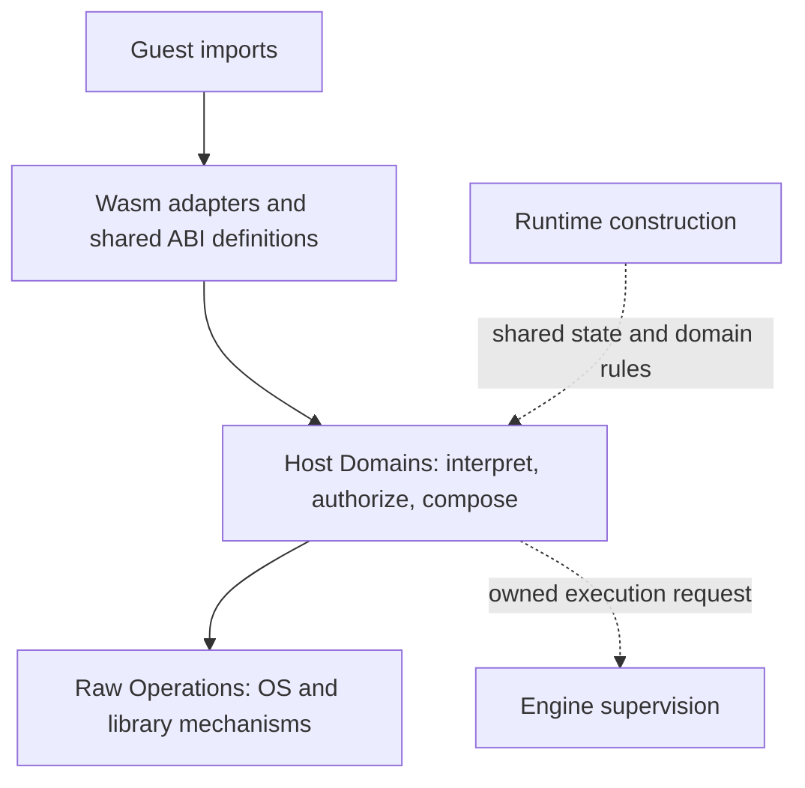

# Moonrun runtime architecture

This guide is the implementation contract for the direction accepted in
[ADR 0012](../../adr/0012-preserve-embeddability-and-runtime-owned-host-semantics.md).
Read it before changing the library interface, execution ownership, host imports,
virtualized state, or authorization. Terms are defined in
[CONTEXT.md](../../../CONTEXT.md); sequencing belongs in the
[architecture tracker](../architecture-tracking.md).

The requirements below describe the intended architecture. The current-state
notes identify incomplete enforcement; this document does not turn those gaps
into existing guarantees. Designs may revise the constraints explicitly, but
moving files or completing a tracking item must not silently weaken them.

## Relationship to earlier decisions

This architecture builds on existing decisions; ADR numbers are local to their
directory. The repository ADR 0001 and Moonrun ADR 0001 are different records.

| Existing decision | Constraint carried forward |
| --- | --- |
| Repository [0001: Async Wasm Host Boundary](../../../../../docs/adr/0001-async-wasm-host-boundary.md) | Keep host semantics independent of V8, preserve native-shaped behavior and provenance, borrow current Guest Memory, and report guest termination without exiting the embedding process |
| Moonrun [0001](../../adr/0001-copy-worker-results-through-host-completions.md), [0004](../../adr/0004-use-host-completion-queue-for-wasm-workers.md), [0007](../../adr/0007-split-read-job-guest-destination-from-host-buffer.md) | Workers retain host-owned inputs/results; copy output through a fresh guest borrow after completion |
| Moonrun [0002](../../adr/0002-preserve-native-shaped-worker-boundary.md), [0003](../../adr/0003-use-native-shaped-worker-threads-first.md), [0005](../../adr/0005-suspend-coroutines-for-wasm-worker-jobs.md), [0006](../../adr/0006-let-workers-own-running-jobs.md) | Preserve the Worker/Job contract, coroutine suspension, chosen thread execution model, and worker ownership of running Jobs; domain separation does not redesign the scheduler |
| Moonrun [0008: Acquired Resources](../../adr/0008-own-resources-behind-boundary-handles.md), [0009: One Handle Namespace](../../adr/0009-use-one-handle-namespace.md) | Validate and acquire resources at the ABI interface; Jobs retain references; Runtime owns one Handle namespace while domains own payloads; future resource rights belong to the acquired payload |
| Moonrun [0010: Stdio Compatibility](../../adr/0010-preserve-stdio-blocking-mode-for-compat-imports.md) | Compatibility imports must preserve embedding-owned descriptor blocking state |
| Moonrun [0011: Generic Stat Result](../../adr/0011-use-a-stable-host-owned-generic-stat-result.md) | Share one host-owned result/codec, keep platform acquisition separate from ABI encoding, and authorize requested metadata effects |

The glossary already defines Runtime Configuration, Runtime State, Moonrun
Policy, Host Domain, Raw Operation, and Wasm Adapter. The
[Rust library documentation](../../../README.md#rust-library) already describes
embedding. This guide connects those existing definitions to ownership and
implementation obligations; it does not claim to introduce them.

ADR 0012 adds Engine lifecycle ownership, one execution-host
interface, the derivation contracts, and the overall authority requirement. It
replaces the repository ADR 0001's original
module allocation, where `async_api` was V8-facing and `async_host` held the
general host state. It preserves that ADR's semantic and lifetime guarantees.
Its original V8/JS plumbing and deferred list are historical; the developer
index describes current implementation and the tracker records remaining work.

Related MoonBuild decisions keep their narrower scope. The
[`moon run` lifecycle design](../../../../../docs/dev/design/moon-run-process-lifecycle.md)
owns outer command execution and artifact delivery; its use of synchronous
child waiting does not choose the Moonrun library's scheduler. Repository
[ADR 0004](../../../../../docs/adr/0004-separate-command-results-from-user-logs.md)
owns MoonBuild command output, not the guest's Runtime Stdio or all Moonrun
diagnostics. Reuse their ownership lessons without importing unrelated modes.

## Library contract and execution ownership

Moonrun must remain usable without starting its CLI, enabling virtual guest
processes, or invoking Moon. The CLI parses arguments, chooses configuration,
connects process signals, and translates returned outcomes into host-process
exit behavior. These actions stay outside the reusable execution interface.

Virtual process interfaces have no current consumers and carry no backward
compatibility requirement. Their types, signatures, defaults, and behavior may
change directly as this architecture develops. Prefer replacing an inadequate
interface over preserving it with adapters or deprecation stages. Tests should
exercise the intended ownership, isolation, and lifecycle contracts rather than
freeze incidental behavior of the experimental implementation. Existing guest
ABIs and ordinary non-virtual execution retain their separate contracts.

`Engine` is the public execution host. It integrates preparation and execution
with admission and lifecycle, while callers select execution placement,
configuration, and authority. Supervision is an Engine responsibility; callers
do not construct a second supervisor or command object. The following
responsibilities have distinct owners within that interface.

| Owner | Responsibility | Existing implementation |
| --- | --- | --- |
| Embedding caller / CLI | Select execution placement, root configuration and grants, signal forwarding, shutdown policy, and outcome presentation | [Library exports](../../../src/lib.rs), [CLI](../../../src/main.rs) |
| Engine | Prepare reusable Loaded Modules, execute Wasm or prepared artifacts, and own execution scopes | [engine.rs](../../../src/engine.rs) |
| Engine supervision | Own process admission, identities, parentage, control, adoption, completion, and reaping | [process_tree.rs](../../../src/process_tree.rs) |
| Artifact preparation | Invoke Moon and retain delivered artifacts without executing guest code or finalizing control | [prepare_artifact.rs](../../../src/prepare_artifact.rs) |
| Run | Execute Wasm synchronously and return after its Runtime and guest execution state have torn down | `Engine::run` and its scoped implementation |
| Runtime | Realize one environment and wire its Host Domains, shared state, Handles, and authorization inputs | [runtime/mod.rs](../../../src/runtime/mod.rs) |

`Engine::run` executes on the calling thread; `spawn(parent, module, options)`
creates a managed thread whose result is consumed by `wait`. Both reuse Modules
and consume `RunOptions`. Thread placement does not select guest process
behavior: `GuestProcessMode::Native` is the compatibility default, and
`with_guest_process_mode(GuestProcessMode::Virtual)` selects virtual identities
and child control. A managed execution has a host control identity in either
mode; guest process operations use virtual identities only in Virtual mode.

`Engine::new` creates an independent process namespace. Clones share its backend
and process table. Table entries retain relationships, control, and completion,
not Engine or Runtime. A running Runtime may refer to its Engine through
Process Context without forming an ownership cycle through the table. Neither
admission nor lookup reconstructs Runtime state from a process entry.

`run_moon` and `spawn_moon` share Moon preparation and artifact dispatch.
`run_file` places loading within the same execution scope as its Run. Internal
`RuntimeConfig` and Host Domains remain private; public `RunOptions` builders
provide the needed control, including owned environments, with one internal
source for each fact.

Whether a Moon/moonx request executes within the embedding host or through an
external process is an execution strategy behind Engine. Current artifact
execution uses an external Moon helper for preparation and runs delivered Wasm
in the embedding host; external delegation of the whole invocation remains
future work. Each strategy must preserve the request's authority ceiling and
explicit ownership of state, completion, and cleanup. It must account for the
different enforcement available in an external process rather than claim that
launch alone constrains it. Backend selection remains separate.

Guest exit and termination return an outcome after teardown. They must not call
`process::exit`, kill the embedding host, or install the CLI's process-signal
broker. Backend initialization that genuinely must be process-wide is allowed,
but its lifetime and interference must be explicit. Diagnostics and Runtime
stdio are separate concerns: embedding callers need deliberate diagnostic
routing as well as guest stream bindings.

Engine owns orchestration for admitted executions. Keep one process table and
one admission path rather than adding a forwarding orchestrator. Parentage,
guest authority over a child, and cancellation membership are different
relationships. Killing one process must not implicitly kill siblings;
cancelling a build may need to stop its helper and compiler descendants. A
session shutdown policy may additionally include adopted descendants.

The owner of a termination receiver finalizes its execution scope. A scoped
Run borrows control; its return cannot close the enclosing execution. Accepted
termination remains authoritative through preparation and cleanup, while a
panic remains an execution failure. Completion requires actual cleanup.
Cancelling a wait must preserve the child and an unread result. Managed results
are published after thread reaping. A caller-thread virtual execution reserves
its result for the synchronous caller and removes its identity on return.
Neither `Terminating` nor dropping an Engine promises that blocked work has
stopped. `request_shutdown(outcome)` closes managed and Virtual admission and
requests termination of all admitted members under the same process-table lock.
It includes adopted descendants without changing single-member `terminate`
semantics. The caller still owns waiting and result consumption. Native
caller-thread execution has no table entry and retains its separate control.

The virtual CLI owns its Engine namespace. It forwards cooperative signals to
the root while the root accepts them; otherwise it retains the first signal,
requests namespace shutdown, and drains adopted roots before applying that
signal to the host. Initialization and finalization are part of this signal
policy, so early signals cannot miss admission and signals during cleanup
cannot bypass it. After finalization, the process signal fallback applies.
Normal root completion still permits adopted descendants to finish naturally.
Preparation-helper cancellation remains separate work: a retained termination
currently waits for helper exit and prevents subsequent artifact execution.

Current limits: the library interface is experimental. Virtual execution,
managed spawning, and external forced interruption currently require V8. These
limits are checked at execution/admission, not Engine construction; ordinary
caller-thread Runs remain available on other supported backends. Unsupported
operations must fail instead of silently weakening the contract. The CLI
signal broker is separate, but worker interruption still installs Unix
process-wide signal behavior. Policy denials also still write to host stderr.
These are embedding ownership gaps, not reasons to put CLI behavior in Engine.

## Three layers for host operations

The three layers describe responsibilities, not a requirement for three crates
or a wrapper around every syscall. Runtime construction and supervision are
separate ownership concerns, outside the per-import call chain.

| Layer | Owns | Must leave to another owner |
| --- | --- | --- |
| ABI adaptation | Engine values, ABI layouts, checked Guest Memory borrows, import registration, error and termination delivery | Environment lookup, path meaning, process admission rules, and permission decisions |
| Host Domains | Interpretation using Runtime State and Handles, complete operation intent, authorization, composition, state updates, and semantic results | Engine handles and guest-memory lifetimes; OS-specific mechanics that do not change domain meaning |
| Raw Operations | OS calls, platform translations, native-library calls, and mechanical resource management | Selecting ambient state, inventing policy, or deciding which guest owns an object |

Shared ABI definitions are part of adaptation, not a fourth semantic layer.
Their main homes are [wasm_imports](../../../src/wasm_imports),
[async_api](../../../src/async_api), [host_imports.rs](../../../src/host_imports.rs),
and domain-specific import registrations. The V8, Wasmtime, and wee8 adapters
provide engine conversion and memory access. Pure value conversions need no
artificial Host Domain or permission check.

Host Filesystem, Host Network, Host Process, SQLite Host, and WASI own their
respective semantics. Env, Working Directory, and Stdio supply shared
Runtime-owned state. Workers schedule Jobs and deliver Completions; they do not
become a second owner of domain interpretation or authorization.

Raw Operations can remain private within a domain, such as
[process/ambient.rs](../../../src/process/ambient.rs), or live in
[async_sys](../../../src/async_sys). Keep platform-specific operations close to
their semantic owner. Reuse mature dependencies where appropriate, but account
for their implicit cwd, environment, signal, and library-global behavior.
Consolidating every primitive into one general OS facade is not a goal.

Within Host Process, [spawn.rs](../../../src/process/spawn.rs) owns request
interpretation, authorization, and resource binding.
[lookup.rs](../../../src/process/lookup.rs) computes executable candidates from
explicit inputs; it has no Runtime, Policy, environment reads, filesystem
probes, or OS calls. [ambient/lookup.rs](../../../src/process/ambient/lookup.rs)
provides the OS observations and probes needed by that interpretation, while
Ambient Process owns native execution. This separation is internal to the
crate; a new crate or general process framework is not required.

For an operation that touches host state, the required flow is:

1. Decode the ABI, validate its memory and Handle representation, and release
   guest borrows before asynchronous work or guest re-entry.
2. Let the domain interpret the request with the owning Runtime's state and
   resource provenance. Resolve defaults and derive every effect it can cause.
3. Authorize the complete intent before its effects. Lookup or preparation
   steps with their own host effects also need an authority decision. Resource
   validity and identity checks remain necessary at the last safe moment.
4. Execute the interpreted operation, then record the semantic result. Async
   work retains owned inputs and acquired resources. Explicitly interpreted
   lookup retains captured defaults; an intentionally selected native Ambient
   operation keeps the platform's native observation points. Execution must
   not substitute ambient values for resolved Runtime inputs or reread guest
   memory.

For example, a process request includes the executable, arguments, environment,
cwd, streams, execution kind, and child restrictions. Host Process owns their
interpretation and authorization; Engine owns admission, preparation dispatch,
execution, and lifecycle. Authorization and execution must agree on the
interpreted request. When lookup is interpreted, a later phase must not redo
it with a different environment. A prepared representation owns the resolved
lookup inputs; it must not duplicate the same fields across peer configurations.
Native Ambient lookup delegates to the platform without freezing its defaults.
Explicit Unix search retains a frozen candidate sequence because an actual
exec failure can require trying the next entry, even if the first entry passed
an access check.

Host Process now has one `prepare_job` entry shared by inline and worker jobs.
It applies the existing lexical process policy before effectful lookup,
interprets the request using the realized Runtime state, binds streams, and
selects native execution or virtual Moon derivation. Native requests retain
platform lookup whenever it can express their Env and cwd; only interpreted
lookup captures the needed Runtime inputs. Pending spawn jobs cannot execute;
prepared jobs cannot accept further guest setters. Native execution consumes
its prepared inputs once, and keeps their stream owner alive through spawn.
Virtual derivation validates the child environment and supplies the selected
Moon tool to Engine without consulting PATH again. Admission and completion
remain Engine responsibilities.

Current limits: process rules authorize the requested program and arguments
(or original Windows command-line prefix), not a stable executable file
identity. This migration does not add filesystem authorization for executable
lookup, constrain native descendants, or expand policy coverage. Some other
imports still directly expose primitives; the full authority model remains
incremental.

## Virtualization and inheritance

Virtualization controls which state an operation observes. Authorization
controls which effects it may cause. Owned Env and a fixed cwd do not by
themselves constrain filesystem, network, or native-code access.

Every Virtual execution, including its root, receives an owned environment and
fixed cwd. Host-facing entries capture missing root values only after Virtual
mode has been selected; explicit environments, including an empty one, and
fixed directories are preserved. Guest derivation supplies complete inputs and
does not use this host fallback. The outer embedding host is the source of root
inputs, not a privileged guest called PID 0. Native mode preserves Ambient
defaults with host-observable effects on either execution placement. It can
also use an owned Env and fixed cwd independently of guest process mode.

| State | Root creation | Guest child derivation |
| --- | --- | --- |
| Env | Capture caller-selected values once, then provision the Runtime Env | Derive from parent state and the explicit child environment; mutations remain child-local |
| Working Directory | Select a fixed execution directory for Virtual mode; preserve explicit selection in either mode | Resolve requested/default cwd from the parent's virtual state |
| Stdio and Resources | Bind explicitly granted resources | Validate and duplicate or delegate selected resources with deliberate ownership and rights |
| Handles | Create a fresh Runtime namespace | Transfer resources through an explicit grant; copying a handle number is not delegation |
| Executable origin | Capture the program's guest-visible origin | Preserve original origin separately from temporary artifact location |
| Authorization | Receive trusted host grants and restrictions | Restrict delegated parent authority; guest configuration cannot add authority |
| Process identity | Allocate at admission | Record parentage separately from state and authority derivation |

Runtime construction consumes configuration and realizes the canonical state
once. Every relevant ABI, domain, worker, and backend must use that state. A
guest path must not secretly fall back to `std::env`, process cwd, host stdio,
or a process-global cache when configured state is available. Owned Env must
not use host-environment write-through as a compatibility shortcut.

Host creation and guest derivation are distinct interfaces. A trusted embedder
can construct independent environments; supplying a parent PID alone neither
inherits state nor establishes a guest restriction. A guest spawn must go
through its parent's Host Process, which derives the child before admission.
Already-resolved state and authorization must not be reconstructed from the
process tree later.

Guest-visible executable origin currently records a load-time pathname; see
[current executable semantics](../current-exe-semantics.md). It is not a stable
file identity proving which OS executable an authorization decision permits.

Executable lookup must respect the Runtime's selected environment and working
directory. Supplying a child environment does not by itself replace the
caller's PATH used for lookup. A Fixed Runtime cwd is caller-cwd virtualization,
not merely a child spawn parameter. An explicit child cwd is a separate input,
resolved against Runtime cwd. Windows executable selection and command-line
interpretation belong in Host Process, not individual FFIs.

Preserve native operations wherever they can express that state correctly.
Policy presence does not choose the implementation; policy provisioning can
produce an owned Env, and that resulting state matters. Owned Env is explicitly
virtualized, including when PATH is absent. Virtual Moon derivation always uses
an explicit plan because it executes through Engine rather than native spawn.

| Execution and Runtime state | Lookup behavior |
| --- | --- |
| Native with Ambient Env and Ambient cwd | Preserve libc `posix_spawnp`/direct spawn or `CreateProcessW(NULL, original_command_line)`, including native observation timing and platform differences. An explicit child-cwd argument remains a native argument. |
| Native Linux with Ambient Env and Fixed cwd | Native child chdir precedes lookup, so libc can implement relative executable and PATH semantics directly. |
| Native Darwin or Windows with Fixed cwd | Interpret lookup explicitly to prevent native caller-directory observations from escaping the Runtime cwd. |
| Native with owned Env | Interpret lookup from caller Runtime PATH, independently of child Env. |
| Virtual Moon child | Interpret lookup and provide complete child configuration before handing the selected helper to Engine. |

On Unix, relative executable names and PATH entries are evaluated in the final
child cwd. Windows instead searches using caller cwd; `lpCurrentDirectory`
configures the child and cannot virtualize that lookup. Darwin's `posix_spawnp`
also performs a parent `stat` of relative candidates, even after successful
spawn. A missing parent-relative file can therefore make it report failure
after creating the child. Fixed cwd uses absolute candidates, so executable
selection and error handling no longer consult that unrelated host directory.
This deliberately avoids reproducing Darwin's parent-stat quirk for virtualized
cwd, including when an explicit child cwd differs from Runtime cwd. Pure
Ambient execution continues to use the platform primitive unchanged.

These rules follow the native implementations and interfaces:
[glibc spawn](https://github.com/bminor/glibc/blob/master/sysdeps/unix/sysv/linux/spawni.c),
[musl spawn](https://git.musl-libc.org/cgit/musl/tree/src/process/posix_spawn.c),
[Darwin spawnp](https://github.com/apple-oss-distributions/Libc/blob/main/sys/posix_spawn.c),
and [CreateProcessW](https://learn.microsoft.com/en-us/windows/win32/api/processthreadsapi/nf-processthreadsapi-createprocessw).
The raw Ambient Process primitives implement these mechanisms; Host Process
chooses which Runtime inputs require interpretation.

For interpreted lookup:

- Caller Runtime PATH selects the executable; the explicit child environment is
  passed separately and does not supply lookup defaults. Preparation captures
  only the state needed for the plan. Ambient inputs needed by this path are
  observed there; owned Env and Fixed cwd supply their own values. Later
  environment changes do not redirect the resulting plan. Capture cwd only
  when relative candidates need a base or Engine requires a complete child
  configuration. Absolute candidates and an inherited or already absolute
  child cwd do not require `getcwd`; an unlinked Ambient directory may still
  be inherited. This freezing rule does not apply to native Ambient lookup.
- Unix relative paths and relative or empty PATH entries use the effective child
  cwd. Explicit paths bypass search. Missing PATH uses the platform's default
  search list; empty PATH searches only the child cwd. Execution tries the
  frozen candidates with platform error handling, including Darwin's shell
  fallback for text found through PATH. On Linux, prepared PATH search uses
  one child process with an `execve` loop. This uses Rust's fork/setup/error
  transport; it does not execute a helper binary. It is not the same cost as
  libc's clone/vfork implementation. Native Ambient search remains
  delegated to libc. Virtual Moon selection checks
  ordinary tool candidates without attempting multiple helper executions.
- Windows ordinary bare-name search uses the embedding application's directory,
  caller Runtime cwd when enabled, native system directories, and caller Runtime
  PATH. The application and system directories are explicit native host inputs.
  `NoDefaultCurrentDirectoryInExePath` comes from Runtime Env. Child cwd does not
  replace caller cwd for lookup. Only an extensionless bare name receives
  `.exe`; explicit paths are used as supplied. The selected image is passed as
  `lpApplicationName`, with the original command line preserved.

The native reference is the platform spawn behavior reachable through
`moonbitlang/async`, not every historical implementation detail of Moonrun.
The older-glibc cwd fallback follows the supported native spawn contract:
raw argv/envp remain intact, GNU and musl do not start a shell on `ENOEXEC`, and
PATH search reports the native execution error. It does not reconstruct the
child environment as a Rust `Command` map or supply an artificial argv0. This
corrects earlier fallback differences rather than preserving them as a second
contract; it does not emulate every pre-2.24 glibc quirk. Windows raw command
line and child cwd retain Win32 empty/NUL-terminated string behavior; interpreted
executable lookup validates its inputs before selecting an image.

Async waits for completion, checks Job errno, raises an OS error and frees the
Job on failure, and only reads a spawn-result handle after success. Preparation
and OS execution failures both follow that sequence. Reading a result handle
after failed preparation is outside that contract and may return `Badf`; it is
not a reason to retain a second mutable or executable request state. Check the
MoonBit wrapper together with the C stub when deciding whether a host behavior
change breaks callers, as required by ADR 0002.

Deliberately deferred work includes complicated PATH and
PATHEXT compatibility, special Windows paths, trusted Moon recognition, and
stable identity across filesystem changes. In interpreted lookup,
drive-relative, rooted-without-drive, and device paths are currently rejected
rather than resolving against hidden host drive state. Interpreted Windows
lookup does not reproduce CreateProcess's successive-prefix guessing for
unquoted executable names containing spaces. Native Ambient Windows execution
continues to delegate these cases to CreateProcessW. Deferral does not permit
introducing new host-global fallbacks for Runtime-owned inputs.

Current implementation: `RunOptions::with_environment` selects an owned source
environment; policy provisioning, when present, consumes that source. An empty
iterator stays empty rather than inheriting host values. Host entries capture
Virtual root defaults through `RuntimeConfig::capture_host_state`; guest spawn
derivation in Host Process selects Virtual mode and supplies environment, cwd,
stdio, and inherited policy explicitly. Admission rejects an incomplete Virtual
configuration rather than falling back to host state. Parent links do not
participate in deriving configuration or policy.

Current limits: Ambient Runs can mutate the host environment.
Library-global state, including Winsock startup/cleanup and Unix signal handlers,
also requires an ownership audit. The current ambient Windows spawn path even
assigns the embedding process to a global Job Object; this is not a child-owned
cancellation scope. Such facilities need an explicit host coordination contract
and controlled Runtime use. Runtime-local objects do not isolate them.

## Overall authority and FFI mapping

Effective Authority is the set of host effects reachable through every exposed
surface, including combinations of operations. Moonrun Policy is one input to
that authority, not its complete representation. Configuration selects state;
binding an already-open file, stream, socket, or preopen additionally delegates
resource access and must be accounted for as such.

The trusted host defines an authority ceiling at construction. Domain rules,
WASI grants, resource delegation, and permitted child execution must each fit
that ceiling. The union of exposed routes matters: denying a path in one FFI
does not deny an equivalent WASI or native route. This is a semantic requirement,
not a requirement for one global policy object on every call.

| Access surface | Semantic and authorization owner | Current coverage / required treatment |
| --- | --- | --- |
| Legacy and async filesystem calls | Host Filesystem with filesystem rules and Resource provenance | Shared domain checks exist; path and handle operations must express the complete read/write/metadata intent |
| Async networking | Host Network with network rules | DNS, socket endpoints, and acquired sockets have distinct effects; keep checks in the domain |
| Process spawn, wait, signal, and kill | Host Process; Engine executes authorized virtual control | Spawn authorization and child provenance exist; executable resolution must be covered by the final interpreted intent |
| SQLite file access | SQLite Host using filesystem authorization | Account for database, journal, temporary-file, and auxiliary access; retain existing policy restrictions on SQLite behavior |
| Env, cwd, executable identity | Runtime-owned state and its provisioning | State selection is distinct from permission; exposing environment values is an explicit data grant |
| Stdio, passed files, sockets, and directory resources | Granting owner plus the receiving domain | Validate lifetime, kind, provenance, and allowed use; a Handle is not an unchecked OS descriptor |
| WASIp1 filesystem and descriptors | WASI descriptor and preopen authority | Currently independent of Moonrun Policy; shares Runtime Env/stdio and derives its preopen from cwd. Uniform authority requires explicit integration |
| Build helpers and compiler descendants | Host-selected preparation plus separately delegated execution authority | Currently retain host access; guest Wasm policy does not sandbox preparation |
| Native executables and Node | Host Process admission plus an explicit native execution contract | Prepared native/JS artifacts are not yet executed by Engine. Native guest process mode preserves existing OS spawn paths; spawn permission does not restrict arbitrary native syscalls |
| Other imports touching host state | The relevant domain or Runtime dependency | Audit clocks, randomness, library initialization, and any direct raw imports; declare unrestricted exposure or enforce a rule rather than assuming filesystem policy covers them |

An FFI name is an ABI entry point, not the unit of policy. Two FFIs with the
same semantic operation use the same authorization rules. One composite FFI
must cover all of its effects. Backend selection, legacy aliases, and sync/async
execution must not create alternative permission behavior. Handle checks add
resource validity and delegated rights; they do not substitute for the domain's
operation checks. A Raw Operation must not add a competing policy decision.
Already-acquired Resource I/O uses the granted object and its allowed operations;
this does not require reopening or reauthorizing its old pathname on every read.
Closing a Handle ends new lookup, while an already-submitted Job may retain its
Acquired Resource until completion.

The table groups surfaces rather than claiming a complete per-import audit.
For each added or changed import, record its semantic operation, Runtime inputs,
required authority, and any indirect effects with the owning domain. For
example, `get_env_var` reads the provisioned Env, `read_file_to_string` requests
filesystem read authority, resource reads use the acquired object's grant, and
WASI `path_open` uses descriptor rights that must also fit the overall ceiling.
Pure value imports can state that they have no host effects. Keep the mapping
next to the operation and its tests instead of maintaining a second permission
schema keyed by import names.

Guest child restrictions must be monotonic: the child's reachable effects are
bounded by the parent's explicitly delegated authority and any additional child
restriction. A child policy file cannot replace a stronger parent restriction.
Trusted host grants are a separate operation and must not be inferred from
parentage, a policy filename, or knowledge of another Runtime's handle number.
Runtime isolation prevents access to the original resource behind another
Runtime's Handles; cross-Runtime resource transfer needs explicit rebinding.

Current limits: policy loading separates environment provisioning from domain
rules and transports canonical inherited policy. Without a policy, existing
domain operations retain their unrestricted behavior; Virtual mode alone does
not change that. Current policy inheritance does not implement a general
intersection of parent authority, child policy, WASI grants, and resource
delegation. Inherited policy currently takes precedence over delivered policy;
that precedence is not a complete restriction algebra. WASI and trusted native
helpers remain separate authority surfaces. SQLite's native VFS and temporary
files, and native TLS system-trust discovery, also need their trusted scope
stated explicitly; existing path checks do not mediate every library effect.
A host may deliberately grant ambient native execution, in which case Effective
Authority includes everything that process can reach. Its own descendants do
not automatically acquire a Moonrun Runtime or virtual identity. A complete
sandbox claim must wait for the relevant surfaces and identity/race guarantees
to be enforced.

Authority, cancellation, and resource budgets are separate contracts. A policy
allowlist does not provide CPU, memory, worker-count, or temporary-disk limits;
accepting a termination request does not bound teardown time. Add each guarantee
where its owner can enforce it, and expose unsupported limits honestly.

## Applying the design to changes

Each architecture change must identify its semantic owner, the Runtime State it
uses, and the authority required for every host effect. New imports need that
mapping before registration; new backends reuse domain behavior. Shared control
flow can be factored where it actually varies, but new forwarding modules or
duplicate configurations need an invariant that the existing owner cannot own.

Also identify any process-global dependency, who coordinates its lifetime, which
scope cancellation targets, and who retains resources until completion. The
behavior must be exercisable through the library without relying on the CLI;
backend capability differences remain explicit.

Keep existing behavior references accurate and record remaining violations in
the tracker and, when touching the implementation, a focused `FIXME` or `TODO`
with its removal condition. Compatibility must be explicit; unsupported
capabilities must fail instead of falling back to ambient execution.

Use the following execution scenarios as evidence, adding tests as each
contract becomes enforceable rather than treating planned coverage as passing:

| Contract | Existing evidence / next acceptance case |
| --- | --- |
| Embedding without host exit | [engine_outcomes.rs](../../../tests/engine_outcomes.rs), [engine_backends.rs](../../../tests/engine_backends.rs); preserve guest outcome and host-error distinction |
| Independent state on shared Engine | [working_directory.rs](../../../tests/working_directory.rs), [stdio.rs](../../../tests/stdio.rs), [process_tree.rs](../../../tests/process_tree.rs); retain explicit Env, namespace, clone, and placement coverage |
| Scope-owned termination and cleanup | [run_termination.rs](../../../tests/run_termination.rs), process-tree unit tests; retain caller-thread and managed execution through loading, preparation, and cleanup |
| Recursive handoff and child control | [recursive_moon.rs](../../../tests/recursive_moon.rs), [moon_handoff.rs](../../../tests/moon_handoff.rs), [guest_process_control.rs](../../../tests/guest_process_control.rs) |
| Equivalent ABI semantics | [legacy_host_imports.rs](../../../tests/legacy_host_imports.rs), [numeric_host_imports.rs](../../../tests/numeric_host_imports.rs), [wasi_imports.rs](../../../tests/wasi_imports.rs); add cross-surface denial tests when authority is integrated |
| Monotonic delegation | Existing policy inheritance tests are a starting point; add child-policy, WASI, resource-transfer, and helper/native grant cases as their enforcement lands |

Prioritize the shared library and domain interfaces and ordinary execution
paths. Helper ownership, native execution, and authorization expansion can then
use those interfaces without redesigning Runtime, imports, and supervision
together. The tracker determines which increment is next; these constraints
continue to apply after that tracker is complete.
